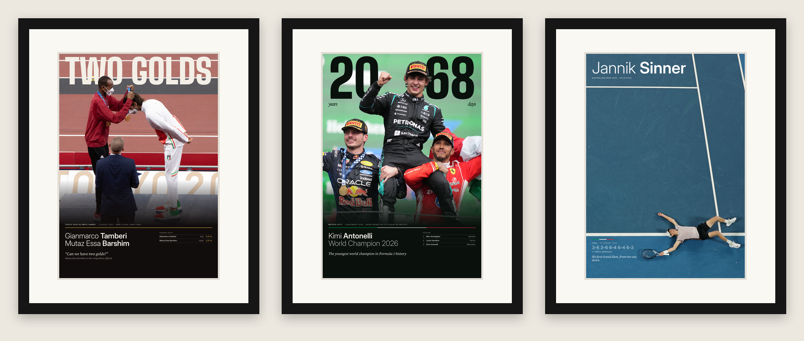

# Poster sportivi A3 — Tamberi & Barshim, Antonelli, Sinner

Tre poster A3 verticali (297 × 420 mm), testi in inglese, pensati per **cornice 40×50 con passe-partout A3** (finestra 29 × 41 cm).



## File pronti per la stampa — `stampa/`

| Poster | PDF (tipografie, es. Pixartprinting) | JPG 300 dpi sRGB (laboratori foto, es. Saal Digital) |
|---|---|---|
| Tamberi & Barshim — "TWO GOLDS" | `Tamberi_Barshim_A3_EN_passepartout.pdf` | `Tamberi_Barshim_A3_EN_passepartout_300dpi.jpg` |
| Kimi Antonelli — "20 · 68" | `Antonelli_A3_EN_passepartout.pdf` | `Antonelli_A3_EN_passepartout_300dpi.jpg` |
| Jannik Sinner | `Sinner_A3_EN_passepartout.pdf` | `Sinner_A3_EN_passepartout_300dpi.jpg` |

- Pagina esatta 297 × 420 mm, font incorporati, foto originali non ricompresse.
- Margini interni di 14 mm: il passe-partout copre circa 4–5 mm per lato, quindi nessun testo viene tagliato.
- Risoluzione effettiva delle foto sul foglio: Antonelli 209 dpi, Tamberi 186 dpi, Sinner 139 dpi (a pagina piena). Non stampare più grande di A3.

## Come stampare

- Formato **A3 / 29,7 × 42 cm esatto**. Non 30×40 né 30×45, che hanno un'altra proporzione.
- Scala **100%**, senza "adatta alla pagina" e senza correzioni automatiche del colore.
- Carta **fotografica opaca o satinata da 200–250 g**, oppure fine art in cotone (Hahnemühle Photo Rag).
- Cornice: **40×50 con passe-partout bianco per A3**, meglio acid-free. Centro dei quadri a circa 145 cm da terra, con 8 cm tra una cornice e l'altra (vedi `anteprime/Mockup_parete_cornici.png`).

## Cose da verificare prima di ordinare

- [ ] **Sinner**: il poster riporta *Australian Open 2024 · Final · 28 January 2024 · 3–6 3–6 6–4 6–4 6–3 vs Daniil Medvedev · "His first Grand Slam, from two sets down."* Va confermato che la foto sia di quella finale. Se è il 2025 (contro Zverev), aggiorna i testi in `sorgenti/build_alt.py` (funzione `sinner`) e in `sorgenti/translate_en.py`.
- [ ] **Preventivi**: confrontare prezzi e spedizione (vedi sotto).

## Preventivi (da fare dal Mac: i siti mostrano i prezzi solo a connessioni italiane)

Consegna: 13836 Cossato (BI). **Non** creare account, **non** pagare: fermarsi prima del pagamento.

1. **Saal Digital** (saal-digital.it) → Poster/FineArt, formato A3 o 29,7×42:
   - superficie Fujifilm Opaco;
   - superficie Hahnemühle Photo Rag.

   Usa i JPG. Codici da provare: `SAALLEAVES` (−25 € con almeno 49,95 € di spesa, fino all'8/11/2026) e il codice di benvenuto per i poster da 15 € (fino al 30/11/2026). Di solito non sono cumulabili.
2. **Pixartprinting** (pixartprinting.it/grande-formato/stampa-poster-altissima-qualita/):
   - carta Ultraphotomatt 2880, base 29,7, altezza 42, verticale;
   - plastificazione "Nessuna" e poi "Opaca solo fronte".

   Usa i PDF. Codice `BENVENUTO`: −20% e spedizione gratis sul primo ordine.
3. Facoltativo: un altro sito serio in A3 esatto (myposter.it, cewe.it).

Risultato atteso: tabella con sito, carta, prezzo per poster, totale per 3, spedizione, sconto, totale finale, data di consegna, più una raccomandazione.

## Rigenerare i file — `sorgenti/`

```bash
pip install pillow pypdf pypdfium2
npm install playwright && npx playwright install chromium
./sorgenti/make.sh
```

Pipeline: `build_alt.py` (varianti HTML e scontorni) → `translate_en.py` (inglese) → `stampa_passepartout.py` (margini per passe-partout) → `render_alt.js` (PDF via Chromium) → `finalizza.py` (A3 esatto e JPG 300 dpi).

- Gli scontorni dei soggetti sono già calcolati (`mask_*.png`, BiRefNet), quindi non serve rembg.
- Font: Inter, Inter Display, Source Serif 4, Big Shoulders Display (licenza SIL OFL).
- `mockup_parete.py` usa gli Inter OTF di sistema (`/usr/share/fonts/opentype/inter/`); su Mac va cambiato il percorso dei font.

## Anteprime — `anteprime/`

- `Panoramica_EN.png`: la serie in inglese, più la variante "Copertina" di Antonelli, non scelta.
- `Mockup_parete_cornici.png`: confronto in scala delle cornici A3, 40×50 e 50×70 sopra un divano da 220 cm.
